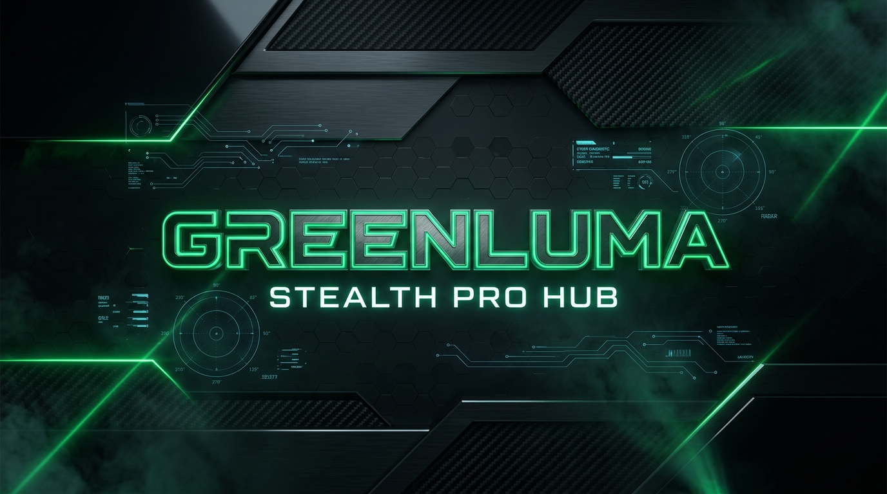

<p align="center">
  
</p>

# 🛡️ GreenLuma Stealth Manager (Open-Source Companion & GUI Hub)

<p align="center">
  
  
  
  
  
  
</p>

---

> [!IMPORTANT]
> ### ⚠️ Critical Clarification & Disclaimer / إخلاء مسؤولية وتوضيح هام
> 
> **English:**  
> **GreenLuma Stealth Manager is an independent, open-source companion utility and graphical user interface (GUI). It is NOT GreenLuma itself.**  
> - **Credits:** GreenLuma and its stealth hook payloads are created and maintained by their original authors (**Steam006** and the **CS.RIN.RU** community).
> - **Purpose:** This project does not contain, reverse-engineer, or claim ownership over GreenLuma. Instead, it serves as an **ergonomic desktop manager** that replaces tedious manual steps (creating `AppList` text files, converting AppIDs, running cache-wiping tools, copying DLLs back and forth, and manually cleaning directories) with a streamlined, modern 1-click dashboard.
> - **Educational Use:** This software is provided strictly for educational and personal library management purposes. It is not affiliated with, authorized, or endorsed by Valve Corporation or Steam.
> 
> ---
> 
> **العربية:**  
> **هذا البرنامج (GreenLuma Stealth Manager) هو أداة مساعدة وواجهة رسومية (GUI Manager) مفتوحة المصدر، وليس هو برنامج GreenLuma نفسه!**  
> - **الحقوق:** برنامج GreenLuma الأصلي وملفات الحقن الخاصة به من تطوير وبرمجة أصحابها الأصليين (**Steam006** ومجتمع **CS.RIN.RU**).
> - **هدف البرنامج:** تم تصميم هذه الأداة لتكون **مساعداً شاملاً ومريحاً** للمستخدم لتوفير عناء الخطوات اليدوية المعقدة (مثل كتابة أرقام الـ AppID في ملفات نصية، مسح كاش ستيم يدوياً، نسخ وتسمية ملفات الـ DLL، والبحث عن إضافات الألعاب)، حيث تجمع كل هذه العمليات في واجهة عصرية وسهلة بضغطة زر واحدة.
> - **إخلاء مسؤولية:** البرنامج مخصص للأغراض التعليمية والتنظيمية فقط، ولا يتبع بأي شكل من الأشكال لشركة Valve أو منصة Steam.

---

## 📑 Table of Contents / جدول المحتويات
- [🇬🇧 English Documentation](#-english-documentation)
  - [What This Tool Does](#-what-this-tool-does)
  - [Key Features](#-key-features)
  - [Quick Start Guide](#-quick-start-guide)
  - [How It Works (Under the Hood)](#-how-it-works-under-the-hood)
  - [Troubleshooting & FAQ](#-troubleshooting--faq)
- [🇸🇦 التوثيق باللغة العربية](#-التوثيق-باللغة-العربية)
  - [ما هي وظيفة هذه الأداة المساعدة؟](#-ما-هي-وظيفة-هذه-الأداة-المساعدة؟)
  - [المميزات الرئيسية](#-المميزات-الرئيسية)
  - [دليل التشغيل السريع](#-دليل-التشغيل-السريع)
  - [كيف يعمل البرنامج تقنياً؟](#-كيف-يعمل-البرنامج-تقنياً؟)
  - [الأسئلة الشائعة وحلول المشاكل](#-الأسئلة-الشائعة-وحول-المشاكل)
- [🛠️ Building From Source](#-building-from-source)
- [⚖️ License](#-license)

---

# 🇬🇧 English Documentation

## 💡 What This Tool Does

If you have ever used GreenLuma manually, you know the friction involved:
1. Looking up numeric Steam AppIDs on database sites.
2. Manually creating an `AppList` directory inside Steam.
3. Generating numbered text files (`0.txt`, `1.txt`...) or editing `AppList.ini` by hand.
4. Making sure text files don't have hidden UTF-8 BOM headers that corrupt the hook's parser.
5. Manually running cache cleaning tools (`DeleteSteamAppCache.exe`).
6. Copying stealth DLLs (`user32SF.dll` / `user32.dll`) into the Steam folder.
7. Remembering to manually delete these files after gaming so Steam returns to its clean, vanilla state.

**GreenLuma Stealth Manager automates every single one of these steps into a single, beautiful desktop application.**

---

## ✨ Key Features

- **🚀 1-Click Smart Launch**:
  - Closes any active Steam processes cleanly.
  - Automatically executes `DeleteSteamAppCache.exe` to wipe stale package caches.
  - Compiles your active library into a **clean UTF-8 (BOM-Free)** `AppList.ini` with base game Slot 90 priority.
  - Injects the stealth engine payload safely into the Steam directory.
  - Launches Steam natively without breaking modern Steam Families features.
- **🔍 Live Steam Store Search Engine**:
  - Type any game or DLC title (e.g. *Arc Raiders*, *Black Myth: Wukong*, *Elden Ring*) or enter a numeric AppID.
  - Instant autocomplete popup with official cover capsules, current price, and Steam Family Sharing status (`[ 👥 Family Share ]` or `[ 🚫 No Share ]`).
- **🧩 1-Click DLC Auto-Discovery**:
  - Base game cards include a **"+ Add DLCs"** button that automatically queries Steam's API and imports all official DLCs for that game into your library in seconds.
- **🛡️ Universal Stealth Engine**:
  - Uses the latest stealth architecture (`user32SF.dll` placed as `user32.dll`) providing full compatibility with modern Steam accounts and Steam Families.
  - Zero hardcoded dependency: drop new or custom GreenLuma DLLs into a `StealthMode/` folder or next to `GreenLumaManager.exe`, and the app prioritizes them automatically!
- **🛑 Automatic Stop & Clean Session**:
  - One click on **`🛑 Stop & Clean Files`** instantly terminates Steam and purges all injected artifacts (`user32.dll`, `user32SF.dll`, `AppList/`, `DeleteSteamAppCache.exe`), leaving your Steam installation 100% untouched.
- **🎨 Frameless Cyberpunk UI**:
  - High-performance, GPU-accelerated native WPF interface with a dark cyberpunk aesthetic.
  - Borderless window with smooth custom title bar controls (Minimize, Maximize, Close) and zero DWM title artifacts.
- **🌐 Dual-Language Support (English / العربية)**:
  - Full support for both English and Arabic with instant dynamic RTL (Right-to-Left) layout switching.
- **📦 Single Portable Executable**:
  - Completely self-contained (~500 KB). No installer, no background services, no Electron, and no Python runtime required.

---

## 🚀 Quick Start Guide

1. Download **`GreenLumaManager.exe`** from the [GitHub Releases](https://github.com/Mayer-ELbot/GreenLuma-Stealth-Manager/releases/latest) page.
2. Run `GreenLumaManager.exe`. (The application will automatically detect your Steam installation directory).
3. Search for the games you wish to unlock using the search bar, or paste their AppIDs.
4. Click **`+ Add DLCs`** on any game card if you want all its expansions unlocked.
5. Click **`🚀 Launch Steam (GreenLuma)`**.
6. Steam will launch with your unlocked games in your library.
7. When you are done playing, open the Manager and click **`🛑 Stop & Clean Files`** (or close Steam) to restore your Steam folder to its completely original state.

---

## ⚙️ How It Works (Under the Hood)

| Step | Technical Implementation | Why It Matters |
| :--- | :--- | :--- |
| **BOM-Free Encoding** | Output uses `new UTF8Encoding(false)` | Standard .NET `Encoding.UTF8` writes a 3-byte Byte Order Mark (`0xEF, 0xBB, 0xBF`). GreenLuma's C++ INI parser fails on this BOM, causing games to show as unowned or "From family library". |
| **Slot 90 Priority** | Base game AppIDs are assigned to slot `90`, with DLCs following sequentially | Slot 90 is the primary account license override in modern Steam; prioritizing base games ensures the game is recognized as directly owned. |
| **AppCache Wipe** | Executes original `DeleteSteamAppCache.exe` with auto-dismiss | Clears cached `packageinfo.vdf` so Steam rebuilds package ownership fresh on boot. |
| **Native Launch** | Empty process arguments (no `-inhibitbootstrap`) | `-inhibitbootstrap` was required in legacy 2020 Steam, but breaks modern 2025/2026 Steam Families authentication. |

---

## ❓ Troubleshooting & FAQ

#### Q: The game appears with a "Purchase" button or says "From your Steam family library"?
> **Solution:** Ensure you use the primary **`🚀 Launch Steam (GreenLuma)`** button. The Manager ensures `AppList.ini` is written without UTF-8 BOM, puts the base game at Slot 90, and automatically clears the Steam appcache before launching.

#### Q: How do I update GreenLuma when a new version comes out?
> **Solution:** You don't need to wait for a new Manager release! Simply drop the newly released `user32.dll` or `user32SF.dll` into the `StealthMode/` folder next to `GreenLumaManager.exe`. The Manager will immediately detect and load the updated payloads.

#### Q: Is this a game crack or pirate software?
> **Solution:** No. This is a configuration manager and launcher helper. It manages local configuration files and helper routines. Any game requiring third-party accounts, external DRM, or server-side authorization still requires legitimate credentials.

---

# 🇸🇦 التوثيق باللغة العربية

## 💡 ما هي وظيفة هذه الأداة المساعدة؟

لكل من استخدم أداة GreenLuma بالطريقة اليدوية سابقاً، فإن المعاناة معروفة للجميع:
1. البحث عن رقم الـ AppID لكل لعبة ولكل إضافة يدوياً عبر المواقع.
2. إنشاء مجلد باسم `AppList` داخل مسار تثبيت ستيم.
3. إنشاء ملفات نصية مرقمة (`0.txt`, `1.txt`...) أو كتابة ملف `AppList.ini` سطراً بسطر.
4. الحذر الشديد من ترميز الملفات (UTF-8 BOM) الذي يجعل ستيم لا يتعرف على الألعاب أو يظهرها على أنها "مستعارة من العائلة".
5. تشغيل أداة مسح الكاش `DeleteSteamAppCache.exe` يدوياً في كل مرة.
6. نسخ وإعادة تسمية ملفات الـ DLL الخاصة بالتخفي داخل مجلد ستيم.
7. تذكر حذف هذه الملفات يدوياً بعد الانتهاء من اللعب ليعود ستيم نظيفاً تماماً.

**برنامج GreenLuma Stealth Manager يقوم بجميع هذه الخطوات بالكامل وبشكل آلي ومثالي وبضغطة زر واحدة فقط!**

---

## ✨ المميزات الرئيسية

- **🚀 زر التشغيل الذكي الموحد (1-Click Launch)**:
  - يقوم تلقائياً بإغلاق أي عملية نشطة لبرنامج ستيم.
  - يقوم بمسح كاش ستيم القديم تلقائياً عبر `DeleteSteamAppCache.exe`.
  - يكتب ملف `AppList.ini` بنظام ترميز نقي تماماً بدون BOM وبأولوية Slot 90 للألعاب الكاملة.
  - ينقل ملفات التخفي (`user32SF.dll` كـ `user32.dll`) لمجلد ستيم.
  - يفتح ستيم فوراً ببيئة نظيفة وجاهزة للعب مباشرة.
- **🔍 محرك بحث مباشر في متجر ستيم بالاسم**:
  - ابحث عن أي لعبة أو إضافة بالاسم المباشر (مثل: *Arc Raiders*, *Black Myth: Wukong*, *Elden Ring*) أو برقم الـ AppID.
  - تظهر قائمة اقتراحات فورية تحتوي على غلاف اللعبة الرسمي، السعر، وبادج يوضح هل تدعم اللعبة المشاركة العائلية أم لا (`[ 👥 عائلي ]` أو `[ 🚫 بدون عائلي ]`).
- **🧩 جلب جميع إضافات اللعبة بضغطة زر واحدة**:
  - يحتوي كل كارت لعبة على زر **"+ إضافة الـ DLCs"** يقوم بالاتصال بستيم وإضافة جميع إضافات اللعبة الرسمية لقائمتك في ثوانٍ.
- **🛡️ محرك تخفي موحد ومتوافق مع التحديثات**:
  - يعتمد محرك التخفي الأحدث لستيم (`user32SF.dll`) المتوافق مع نظام العائلات وجميع الألعاب.
  - إمكانية التحديث الذاتي: عند صدور أي تحديث لملفات GreenLuma، يكفي وضع الـ DLL الجديد في مجلد `StealthMode/` أو بجانب البرنامج وسيتعرف عليه تلقائياً.
- **🛑 إنهاء الجلسة والتنظيف الفوري**:
  - بضغطة زر واحدة على **`🛑 إيقاف وحذف الملفات`**، يتم إغلاق ستيم وحذف أي ملفات حقن فوراً من مجلد ستيم ليبقى جهازك وحسابك نظيفاً 100%.
- **🎨 واجهة احترافية داكنة خالية من الحواف**:
  - واجهة WPF سريعة للغاية تعمل بتسريع كارت الشاشة (GPU Acceleration).
  - بدون إطار ويندوز الأبيض العلوي المزعج، مع شريط أدوات تحكم خاص (تصغير، تكبير، إغلاق).
- **🌐 دعم كامل للغتين (العربية والإنجليزية)**:
  - واجهة كاملة باللغة العربية مع محاذاة من اليمين لليسار (RTL) مع إمكانية التبديل للإنجليزية فوراً.
- **📦 ملف تنفيذي محمول واحد**:
  - حجم البرنامج حوالي 500 كيلوبايت فقط، لا يحتاج لأي تثبيت أو برامج مساعدة (لا يحتاج متصفح أو بايثون).

---

## 🚀 دليل التشغيل السريع

1. حمّل أحدث نسخة من ملف **`GreenLumaManager.exe`** من صفحة الـ [Releases](https://github.com/Mayer-ELbot/GreenLuma-Stealth-Manager/releases/latest).
2. افتح ملف `GreenLumaManager.exe` (سيتعرف البرنامج تلقائياً على مسار ستيم في جهازك).
3. ابحث عن الألعاب التي تريد فتحها في شريط البحث أو اكتب رقم الـ AppID.
4. اضغط على **"+ إضافة الـ DLCs"** لأي لعبة تريد فتح إضافاتها.
5. اضغط على الزر الأخضر الرئيسي: **`🚀 تشغيل ستيم مع GreenLuma`**.
6. سيفتح ستيم وستجد الألعاب في مكتبتك وجاهزة للتحميل واللعب.
7. بعد الانتهاء من اللعب، اضغط **`🛑 إيقاف وحذف الملفات`** في البرنامج ليعود ستيم أصلياً ونظيفاً تماماً.

---

## ⚙️ كيف يعمل البرنامج تقنياً؟

| الخاصية | التنفيذ البرمجي | الفائدة والأهمية |
| :--- | :--- | :--- |
| **منع ترميز BOM** | استخدام `new UTF8Encoding(false)` | كود C++ في GreenLuma يفشل في قراءة ملف `AppList.ini` إذا وُجدت حروف البداية المخفية لـ BOM (`EF BB BF`)، مما كان يسبب ظهور الألعاب كأنها مستعارة أو غير مملوكة. تم حل المشكلة نهائياً. |
| **أولوية Slot 90** | وضع معرف اللعبة الأساسية في الخانة 90 | في نظام ستيم الحديث، الخانة 90 هي الأساسية لتراخيص الحساب، ووضع اللعبة فيها أولاً يضمن التعرف عليها كلعبة مملوكة مباشرة. |
| **مسح الكاش الآلي** | تشغيل `DeleteSteamAppCache.exe` مع إغلاقه التلقائي | مسح ملف `packageinfo.vdf` القديم ليقوم ستيم بإعادة بنائه بالتراخيص الجديدة فور فتحه. |
| **إقلاع ستيم النظيف** | إطلاق ستيم مباشرة بدون `-inhibitbootstrap` | المعامل `-inhibitbootstrap` القديم أصبح يسبب مشاكل في نظام عائلات ستيم لعام 2025/2026، والتشغيل النظيف يضمن استقرار الاتصال. |

---

## ❓ الأسئلة الشائعة وحلول المشاكل

#### س: اللعبة تظهر في ستيم لكن مكتوب "شراء" (Purchase) أو "من مكتبة العائلة"؟
> **الحل:** استخدم الزر الرئيسي **`🚀 تشغيل ستيم مع GreenLuma`** حصراً؛ حيث يقوم البرنامج آلياً بمسح الكاش، وترتيب ملف `AppList.ini` بنظام خالٍ من BOM وبأولوية Slot 90 للعبة الأساسية، مما يضمن ظهورها كأنها مشتراة بحسابك مباشرة.

#### س: كيف أقوم بتحديث ملفات GreenLuma مستقبلاً عند صدور نسخة جديدة؟
> **الحل:** لست بحاجة لانتظار تحديث لهذا البرنامج! كل ما عليك هو أخذ ملفات الـ DLL الجديدة ووضعها بجانب ملف `GreenLumaManager.exe` أو داخل مجلد باسم `StealthMode/`، وسيقوم البرنامج تلقائياً باستخدام الملفات الأحدث بدلاً من المدمجة.

#### س: هل البرنامج آمن على حساب ستيم؟
> **الحل:** نعم، فالبرنامج لا يقوم بأي تعديل دائم على ملفات ستيم، وملفات التخفي المؤقتة يتم حذفها فوراً عند الضغط على زر الإيقاف أو الخروج، ليعود مجلد ستيم أصلياً وخالياً من أي أثر.

---

## 🛠️ Building From Source

You don't need Visual Studio installed. Any standard Windows machine can build the standalone executable in seconds using the included build script:

```cmd
git clone https://github.com/Mayer-ELbot/GreenLuma-Stealth-Manager.git
cd GreenLuma-Stealth-Manager
Build_EXE.bat
```

The resulting `GreenLumaManager.exe` will be generated in the root directory.

---

## ⚖️ License

Distributed under the **MIT License**. See [LICENSE](LICENSE) for more information.  
*All trademarks, logos, and brand names are the property of their respective owners.*
